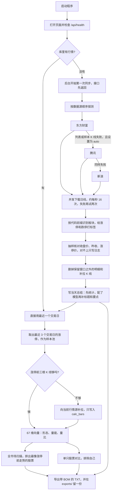
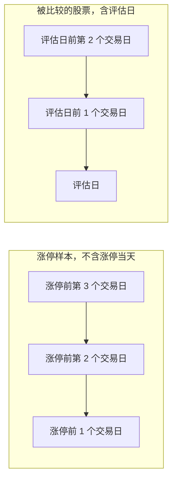
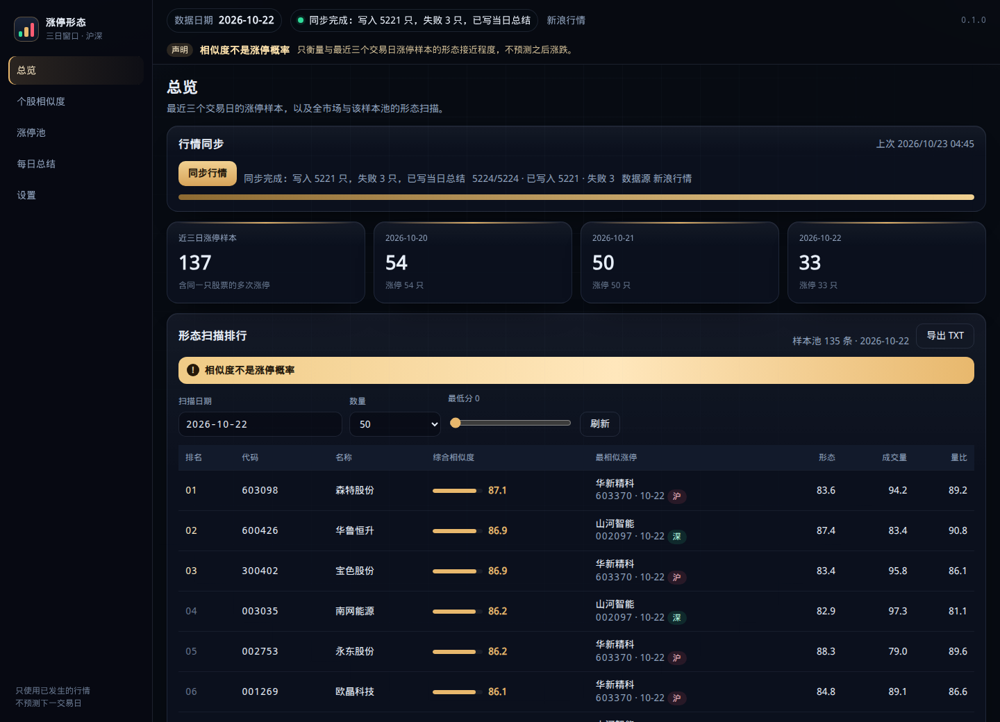
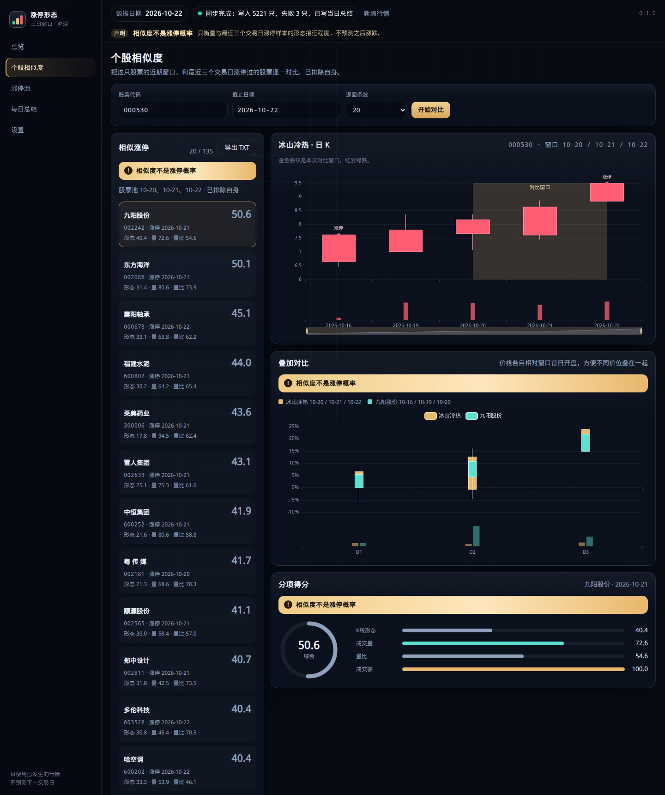
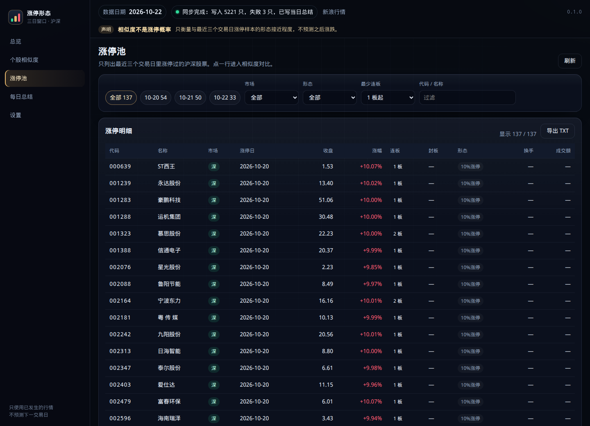
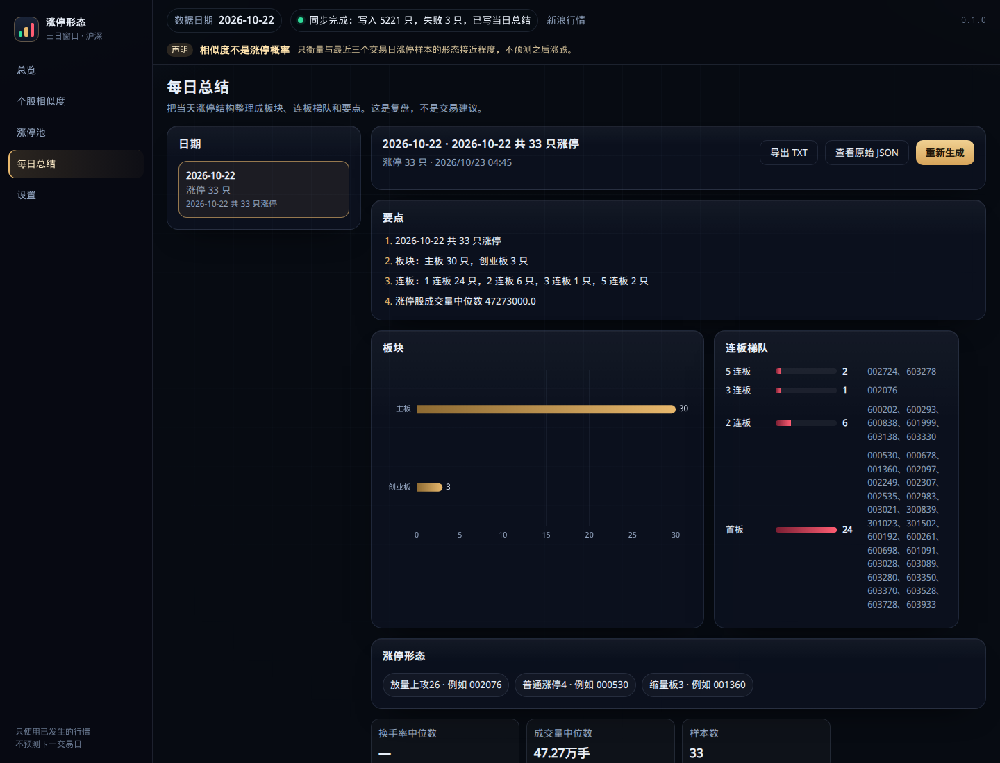
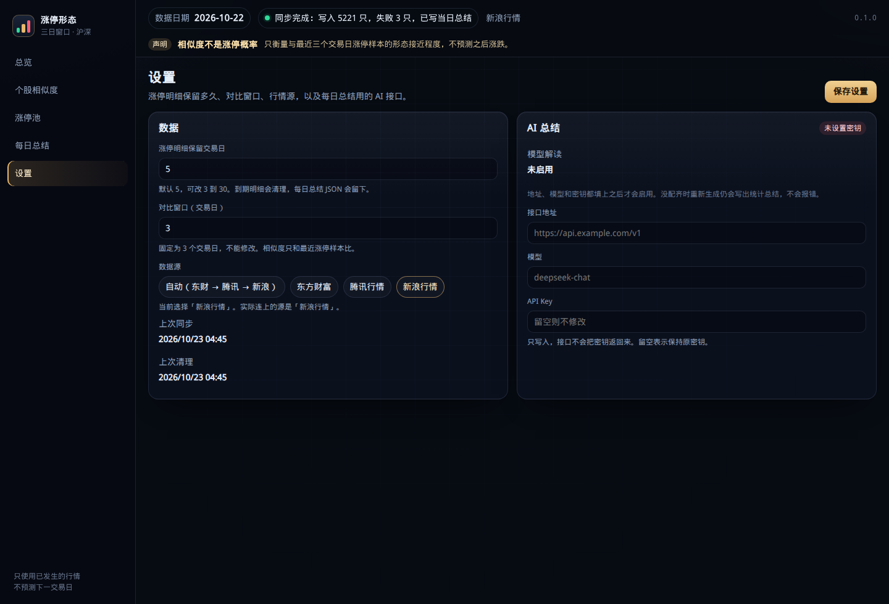

# 三日涨停形态统计系统

看沪深 A 股里，最近涨停的股票在涨停前三天怎么走，再拿其它股票最近三天的走势去比，给出 0 到 100 的形态相似度。

分数只回答「像不像」。它不是涨停概率，也不构成投资建议。

## 目录

1. [核心硬规则](#核心硬规则)
2. [完整数据流程](#完整数据流程)
3. [开发路线图](#开发路线图)
4. [界面设计方向](#界面设计方向)
5. [快速上手](#快速上手)
6. [配置](#配置)
7. [目录结构](#目录结构)
8. [接口](#接口)

更细的口径在 [docs/rules.md](docs/rules.md)，字段和路径在 [docs/api.md](docs/api.md)，每日总结的 JSON 在 [docs/summary_schema.md](docs/summary_schema.md)。

## 核心硬规则

- **相似度不是涨停概率。** 页面顶栏、结果卡片和导出文件里都写着这句原文。
- **概率列与预测分都是历史统计，不是预测。** 盘中榜的「次日涨停率」是「同一相似度档在回测里下一交易日真的涨停的比例」；预测池的综合分是三项历史证据的加权。样本不足 50 条、没有回测、或那一档没出现过时，数字留空显示「—」，不拿 0% 冒充。
- **只用行情。** 不读新闻、公告、财报，也不让模型改写已经算好的数字。
- **不用未来数据。** 评估日之后的 K 线一律丢掉。样本窗口和候选窗口不是同一段，见下面的流程图。
- **明细只留大约一周。** 行情、涨跌停标签、补拉来的计算 K 线，默认留最近 5 个交易日，可在 3 到 30 之间改。到点删除，同步结束也会删一次。
- **每日总结永久保存。** 数据库里的 `ai_daily_summaries` 和 `summaries/YYYY-MM-DD.json` 不参与上面的清理。
- **只和最近 3 个交易日里涨停过的股票比。** 这个 3 不能在设置里改。同一只股票的全部涨停样本都会排除，避免自己跟自己比。
- **默认只做主板和创业板。** 上证主板 `600/601/603/605`，深证主板 `000/001/002/003`，创业板 `300/301/302`。`302` 仍是创业板，涨跌幅 20%（302132 中航成飞由 300114 改码而来）。科创板 `688/689` 默认剔除，不同步、不进涨停池、不参与打分、不进总结和导出。查询科创板代码会得到「科创板不在纳入范围」。环境变量 `EXCLUDED_BOARDS` 默认是 `star`。B 股（`900`/`200`）、北交所、基金、债券、指数都丢掉。行情源如果把市场前缀标错，以 6 位代码前缀为准。

涨停价按「前收盘 ×（1 + 比例），四舍五入到分」。主板 10%，创业板 20%。主板 ST 在 2026-07-06 之前是 5%，从那天起是 10%；创业板 ST 仍是 20%。2020-08-24 及之后上市的创业板、2023-04-10 及之后上市的主板新股，上市前 5 个交易日不设涨跌幅。没有上市日期时，不做这条豁免。科创板的 20% 规则仍留在判定函数里，默认不参与计算。

## 完整数据流程



下面按这个顺序说明每一步实际做什么。这条链是收盘后的主流程；盘中那一圈（监控榜刷新、11:30 半天线冻结、报警榜采样）不在这张图上，看「盘中监控与报警榜」一节和 [docs/api.md](docs/api.md) 里的那两个接口。

### 启动和首次同步

桌面程序或 `python -m backend.app.main` 都只监听 `127.0.0.1:8765`。库是空的时候，服务先起来，再在后台同步，不挡住页面。进度看 `/api/sync/status`：阶段、已完成只数、总数、写入数、失败数，以及一句中文说明。

`auto` 的探测顺序是东方财富、腾讯、新浪。列表能拉下来、并且抽一只股票的日线也能拉下来，才认定这个源可用。设置里如果指定了某一个源，这一轮只用它。`auto` 在下载过程中如果某个源开始返回 5xx 或限流，这一只和还没下的股票会改用下一个源，每只行情记下实际来源。

成交量统一成股（手 × 100），成交额统一成元（万元 × 10000），换手率用百分数。日线用不复权，不用腾讯的前复权 `qfqday`，否则涨停价会被缩放。新浪日线常常没有换手率和成交额：换手率尽量用其他源补，成交额补不到就用成交量乘均价估算，并标成估算。

### 沪深识别和涨停判定

每只股票先过代码前缀。过不了的不入库，科创板默认也在这里丢掉。已经在库里的科创板记录，启动和清理时删除。通过的按板块取涨跌幅比例，用前收盘算出涨停价和跌停价，再看收盘是否封住。停牌（成交量为 0）不算涨停。一字板在列表里单独标出来；日线里没有首次封板时间，所以这一列是空的。

### 两种三日窗口

两边都是三个交易日，但起点不同。



样本描述的是「涨停之前的样子」。候选描述的是「到评估日为止的最近三天」。同一天不会被拿去和它自己的涨停样本比。

### 三日涨停池、补拉和打分

样本池只收最近 3 个交易日里真正涨停的记录。同一只股票这三天里涨停多次，会分成多条样本。

明细默认只留 5 个交易日，所以最老那天的涨停，前面三根 K 线经常已经不在正式行情里。打分前会向当前行情源补拉，结果放进 `calc_bars`，不改正式行情。日 K 接口在正式行情没有的日期上，会把这些柱补出来。补拉失败，或补完仍不够三根，这条样本不参加打分，出现在结果的 `skipped` 里，并写明中文原因。补拉同样不能使用评估日之后的数据。清理明细时，早于保留窗口的补拉数据一起删掉。

每根窗口收成 67 个数：20 个日特征 × 3 天，再加 7 个三日汇总（收益、斜率、波动、量能趋势、振幅和、上涨天数、位置变化）。样本先做稳健缩放（中位数和四分位距），再用加权欧氏距离和余弦相似度混合，比例是 0.8 和 0.2。距离换成 `100 × exp(-距离)`，分数落在 0 到 100。

页面上的三项是从这 67 维里切出来的，再按固定权重加总：

| 分项 | 权重 | 看什么 |
| --- | --- | --- |
| 形态 | 0.60 | 开高低收、实体、影线、振幅、价格位置 |
| 量能 | 0.25 | 成交量大小和三日量能变化 |
| 量比 | 0.15 | 量比和换手率 |

成交额单独放在 `other_scores.amount`，不进总分。缺成交额时，这项没有区分度，不会被当成 0。两边都没有成交额时，这条参考分会靠在一起，页面上可能接近 100，读的时候不要把它当成「成交额特别像」。

### 全市场扫描和单只对比

扫描把评估日有行情、并且凑得齐三天窗口的股票，逐一去和样本池比，排除自己之后取得分最高的一条，再按分数排序。个股页用同一套分数，并列出样本自己的三天日期，方便和 K 线叠在一起看。

### 每日总结

同步写完会重写最近一个交易日的总结。18:10 再检查一次，这一天还没有文件才补，避免把已经写好的内容覆盖掉。

没填 AI 地址、模型和密钥时，仍然写统计版：涨停家数、板块（主板 / 创业板，没有行业题材，也不含科创板）、连板梯队、量能中位数。`source` 为 `statistics`，`model` 为空。三项都填了之后，模型只许改标题和要点，数字仍以本地计算为准，`source` 为 `ai`。模型失败时统计版留下，原因写在 `ai_error`。

### 导出 TXT

总览、个股相似度、涨停池、每日总结各有一个「导出 TXT」。请求 `GET /api/export`，正文是 UTF-8 带 BOM 的纯文本，方便记事本打开。文件名形如 `scan_2026-10-22.txt`。响应头带 `filename` 和 `filename*`。数据目录的 `exports/` 总会再留一份。表头包含生成时间、数据日期、对比池、数据源，以及「相似度不是涨停概率」。

桌面版如果跑在 pywebview 里，导出会先弹出系统另存为对话框，按 UTF-8 BOM 写入。

### 每日定时任务

时区是北京时间。`LP_SCHEDULER=0` 时全部不跑。

| 时间 | 做什么 |
| --- | --- |
| 10:00 | 把当时那份相似榜前 100 行备成当天 AI 固定榜的输入。只算本系统自己的数，一分钱不花、一次网关都不敲；那天不是交易日时会被「交易日必须是今天」那道闸挡回来，原因写进日志 |
| 17:10 | 同步当天行情，写完接着清理过期明细、跑一遍十四项数据质量检查，并重写当天总结 |
| 17:40 | 再清理一次过期明细 |
| 18:10 | 当天总结如果还没有，补写一份。同步仍在跑时跳过 |

周末和节假日没有新行情时，同步可能失败或写不进新的一天。已有的总结不会被删。质量检查跑不成的那几轮不变成安静的 0：它会写在同步完成的那句消息里。

## 开发路线图

第一阶段是现在仓库里能双击或用源码跑起来的部分。表里 ✅ 指这条能力已经三层接通：后端有实现、有 HTTP 接口、页面上用得上；⏳ 差在哪一层，表下那几段逐条说清——有的是只写了算法文件没接线，有的是接口都齐了但页面上还没有那一块。

| 状态 | 能力 |
| --- | --- |
| ✅ | 东方财富、腾讯、新浪三个行情源。`auto` 在 5xx 或限流后逐只换源，每只记下实际来源，一轮下来还留一份「哪个源各出了多少只」的账 |
| ✅ | 同步后抽样核对收盘价、昨收、涨停价 |
| ✅ | 沪深 A 股过滤、涨停价四舍五入到分、ST 和新股前 5 日的规则 |
| ✅ | 两种三日窗口、最近 3 个交易日涨停池、排除自身、不用未来数据 |
| ✅ | 涨停前 K 线不够时按需补拉，失败写入 `skipped` |
| ✅ | 形态 / 量能 / 量比打分，全市场扫描和单只对比 |
| ✅ | 每日总结的统计版和 AI 版，JSON 永久保留 |
| ✅ | 四页导出 TXT，桌面版可走系统保存对话框 |
| ✅ | 明细按交易日清理，设置页能看保留天数和上次清理时间 |
| ✅ | 空库首次启动自动同步，状态接口用中文说明进度 |
| ✅ | 九个页面：总览、盘中监控、个股相似度、涨停池、次日预测池、每日 AI 固定榜、每日总结、历史回测、设置 |
| ✅ | Windows 桌面程序：无控制台、WebView2 窗口、关闭缩到托盘 |
| ✅ | 盘中监控：交易时段刷新榜单，榜前 50 只每 2 秒随请求重算，全市场每 120 秒由后台线程跑一轮 |
| ✅ | 11:30 半日冻结：上午用当天现造的半日 K 线，11:30 之后不再写入、冻在文件里，下午的形态窗口读这份冻结值 |
| ✅ | 报警榜：只盯前一交易日固定榜挑出的那几名，涨过 3% 报一次、涨过 6% 且在跳升时把窗口置顶；页面有浮层，桌面版还有窗口标题和托盘提示，点「知道了」才放开 |
| ✅ | 历史回测：逐日重算相似度、按档统计下一交易日涨停率；按交易日切前后两段的校准（Brier / 对数损失 / ECE）、四条泄漏自检加抽验重算；跑成的账落库，跑砸也留一行 `failed` |
| ✅ | 盘中榜的概率列：每行按最高相似度落档，读最近一次**已完成**回测的档位次日涨停率；没有回测或样本不足 50 条的档显示「—」，不显示 0% |
| ✅ | 次日预测池：当日未涨停的股票按形态、连板延续、档位发生率三项历史证据加权排序；连板证据只查严格早于基准日的结果 |
| ⏳ | 聚类：把涨停前形态分成几组再看 |
| ✅ | 每日 AI 固定榜：每天上午 10:00 凑好那 100 行输入（一分钱不花）、页面上点一次才让模型排出前 20 名，第二天盘中就盯这几名。它不是按历史发生率挑的预测池，也不给涨停概率 |
| ✅ | AI 深度分析：多条证据交给模型写结论，数字仍须能对回本地统计；整榜分析和单只直评都有，页面不给模型编的数留位置 |
| ⏳ | 数据质量闸门：十四项检查跟着每轮同步真跑、脏行清理有三道闸，四个接口都能读能预演，差的是页面上还没有那本账 |
| ⏳ | 多个 AI 网关切换、行业题材、封板时间、Docker 镜像 |

聚类那张 ⏳ 还停在算法文件：`backend/app/algorithms/clustering.py` 有 KMeans 加轮廓系数选 k，没有服务调用、没有 HTTP 接口、页面上看不见。回测已经三层接通：`backend/app/services/backtest_service.py` 逐日重算并落库，接口在 `docs/api.md` 的「历史回测与次日预测池」一节，页面是「历史回测」和「次日预测池」两页。`ai_evidence.py` 里「相似度分档的次日发生率」这条证据也接回来了，吃的是同一份回测账——盘中 AI 分析、榜上概率列、预测页的档位项读的是同一条记录，不各算一套。

质量闸门那张 ⏳ 差在另一头，是三层里缺最上面那一层：`backend/app/services/quality_service.py` 的十四项检查每轮同步末尾都真跑一遍（跑不成会在同步消息里说破，不会安静地变成 0），账落进 `data_quality_errors`；`purge_service.py` 的清理默认只预演、删除比例超 5% 直接拒、删完只复查一遍不再删第二轮。四个接口见 `docs/api.md` 的「数据质量闸门」一节。

最后一行那四件是一件都没有：设置里只有单套地址、模型、密钥，没有可切换的网关清单；行业题材没有数据源，页面上那个「板块」是交易所板块（主板、创业板）不是行业；封板时间日线里给不出来，`first_limit_time` 永远是 null、涨停池那一列永远显示「—」；仓库里没有 Dockerfile，也没有 compose 文件。

## 界面设计方向

页面是深色金融终端，不是说明文档。信息靠数字、表格和图，不靠大段解释。

### 整体风格

| 用途 | 颜色 |
| --- | --- |
| 页面底 | `#070b12`，左上偏蓝、右上偏金的两层光晕，再加很淡的网格 |
| 卡片 | 接近 `#0c1220` 的半透明，细边框，大圆角 |
| 顶栏 | 半透明并模糊，滚动时钉在上面 |
| 正文 | `#e7eef8` |
| 次要文字 | `#8ea0bb` |
| 强调 | 金色 `#e8b86d`，用在当前导航、主按钮、对比窗口底纹 |
| 上涨 | `#ff5d73` |
| 下跌 | `#2fdb9a` |

字体优先用文泉驿微米黑、思源黑体、苹方、微软雅黑。数字用等宽对齐。主按钮是金色渐变，次按钮是幽灵边框。

留白按卡片分组：一屏里先是页标题，再是一块操作，再是结果。卡片之间留出缝，不把表格嵌进另一张表格。动效只留给图表入场（大约 280 毫秒）和同步进度条，没有装饰性的循环动画。对比度按深色底上的浅字来配，金色只做强调，不拿来写长句。

### 信息架构

左侧固定九个入口：总览、盘中监控、个股相似度、涨停池、次日预测池、每日 AI 固定榜、每日总结、历史回测、设置。报警榜不单独开页，它是盘中监控页里的一张表加一个浮层。后面如果做聚类，仍加在设置上面，用同一侧栏，不另开窗口。

顶栏从左到右是数据日期、同步状态、实际行情源、版本号。顶栏下面永远有一条声明：「相似度不是涨停概率」。侧栏底部写着「只使用已发生的行情，不预测下一交易日」。

窄屏时侧栏改成顶部，表格横向滚动，不把列挤到看不清。

下面五张图是 2026-10-22 的真实行情，拍摄时还没做「中途换源」和「成交额估算」。那一轮东方财富列表没有连上，腾讯日线中途返回 HTTP 501，于是整轮停在新浪，换手率和成交额是空的。现在 `auto` 会在 5xx 或限流后逐只改用下一个源；成交额补不到会标成估算。

### 总览

上半是同步：按钮、中文进度、已完成/总数、进度条。同步从进行中变成结束时，自动刷新数据日期和排行。

中间是最近三个交易日的涨停家数。下面是全市场扫描表：排名、代码、名称、综合分、最相似的涨停样本、形态、量能、量比。点一行进入这只股票的相似度页。最低分和条数在表上方改。右上角是「导出 TXT」。



### 个股相似度

输入 6 位代码和截止日期。还没查的时候，用涨停池里的几只股票当快捷入口。

结果左边是相似涨停列表，右边三块叠在一起：这只股票的日 K（金色底纹标出对比窗口）、与选中样本的叠加图、分项得分。叠加图把两边价格都换成相对各自窗口首日开盘的涨跌，避免高价股和低价股画不到一起。点列表里的另一条会换右侧的样本。导出带上代码和条数。



### 涨停池

只列最近三个交易日的涨停。可以用日期、沪市/深市、形态、最少连板、代码或名称过滤。表里有收盘、涨幅、连板、封板时间、形态、换手、成交额。封板时间日线里没有，显示「—」。换手补不到就显示「—」。成交额如果是估算，数字后面会标「估」。点一行，用这只股票的涨停日作为相似度页的截止日期。导出使用当前筛选对应的日期；选「全部」时用最近一个交易日作为评估日，文件里仍包含这三天的池。



### 每日总结

左边按日期列出已保存的总结，右边是标题、要点、板块条形图、连板梯队、形态计数和量能。可以展开原始 JSON，也可以重新生成。没配模型时，重新生成得到的是统计版，页面不报「未配置」。



### 设置

数据区：保留交易日（3 到 30）、固定为 3 且不能改的对比窗口、四个数据源按钮（自动、东方财富、腾讯、新浪）、实际连上的源、上次同步、上次清理。

AI 区：模型解读是算出来的状态，地址、模型和密钥都有才算启用。密钥只写入，不回显；留空表示不改。没配齐时总结仍会生成。



### 盘中监控与报警榜

盘中监控页上面是刷新节奏和选榜口径（榜前若干只每 2 秒随请求重算，全市场每 120 秒一轮），下面是榜。榜单多一列「次日涨停率」：按这一行的最高相似度落档，读最近一次已完成回测里同档的次日实际涨停率，底下用小字写那一档的观测数。没有回测、这一档没出现过、或观测不足 50 条时显示「—」，不是 0%——「这一档从没涨停过」和「这一档还没有数」是两句话。口径卡片里写着这份数来自第几次回测。

报警榜是这一页里单独的一张表，只盯前一交易日固定榜挑出的那几名，列是名次、股票、昨日分、最新价、今日涨幅、近 N 分钟跳升、状态，未确认的行后面跟一颗「知道了」。判据和阈值只有后端一份，页面那些数字（包括那个 N 分钟和几个点）全从接口回包里读。涨过 3% 报一次，页面弹浮层并响一声；涨过 6% 且窗口里跳升够 2 个点以上额外把窗口置顶。每只股票每天每一档只报一次，置顶只由「知道了」解除——点下去页面这一拍就把浮层和标题撤掉，桌面那一层在下一次读取时（最慢 `poll_seconds` 那一拍）跟着放开。配色沿用同一套红涨绿跌，不为报警新开一套颜色。

桌面版在页面之外还有一层：程序自己的线程读同一份账，把窗口摞到最前、窗口标题写成「⚠ 涨幅报警 N 条待确认」、往托盘发一句。这一层不认识阈值，也不自己判档位，后端说该置顶才置顶；读接口失败时维持上一份，不会因为一次网络抖动就把已经摞着的窗口放下来。

### 历史回测

上面是区间和「最多跑几天」，点一下在后台跑，页面每 2 秒读一次进度，跑完自动刷新。中间是四个数：交易日、观测条数、全样本基准发生率、校准 ECE（旁边带 Brier 和对数损失）。再下面是泄漏自检（四条结构判据 + 抽验重算的明细）、分档发生率表、按交易日切分的校准表、逐日表、观测明细分页（可按档位筛）。

概率留空的地方显示「—」。区间最后一天的结果还没揭晓，它进的是「待揭晓」而不是「没涨停」。台账里跑砸的那一行留着，写着「跑砸了」和错误原因；删一轮回测要先确认，删掉的只是派生账，原始行情一根都不碰。

### 次日预测池

选一个挑选日（不选就用最近一个交易日），页面给出当天全市场里「还没涨停、但形态最像涨停前」的一批股票，按三项历史证据加权排序：形态（0.5）、相似案例的连板延续（0.3）、档位历史发生率相对基准的倍数（0.2，2 倍封顶）。缺项不按 0 算，权重摊给其余项，页面上照实写缺了哪项。

表里每行带最高/平均相似度、高相似样本数、档位、档内次日涨停率与样本数、连板延续的已知/命中/缺失数、综合分和三项原值。没有回测时档位项整列退场，页面顶部说清「跑一次回测后自动接上」。这一页不给「建议买入」，也不把预测分叫成概率。

### 后续页面怎么排

聚类还没有做，沿用同一套侧栏、卡片和红涨绿跌：表格加一个图，不在这些页上写「建议买入」。

### 图表

- **K 线**：阳线红、阴线绿。下方成交量用同一套颜色。对比窗口用金色半透明块标出，块上写「对比窗口」。接近涨停的收盘可以点一个小标记，标记是辅助，不代替涨停标签。
- **叠加**：横轴是窗口里的第 1、2、3 天，不是日历日期。两条线各用各的基准。某一天没有 K 线时该点空着，不拿后一天去补。
- **得分**：综合分用圆环，分项用横向条。不使用雷达图。三项权重并不相等，雷达会把它们画成同一个多边形，成交额又不进总分，放进雷达更容易看错。
- **板块**：每日总结用横向条形，长度是家数。没有行业数据时，条的名字就是主板、创业板。科创板默认不出现。

### 免责声明放在哪

1. 顶栏常驻，每个页面都能看见，原文是「相似度不是涨停概率」。
2. 扫描和相似度的结果卡片再显示接口返回的 `disclaimer`。接口如果没带回这句，页面仍补上这句。
3. 导出文件的表头用同一句，不改写。
4. 每日总结的页头写「这是复盘，不是交易建议」。总结 JSON 里不另造一句预测。

### 桌面窗口和托盘

双击 `LimitPattern.exe` 后没有黑色控制台。程序用 WebView2 打开内嵌窗口。点关闭是缩到托盘，不是退出。托盘菜单有「显示」和「退出」。同一 Windows 登录会话里只允许一个实例，再次双击会把已有窗口叫出来。

端口默认 8765，被占用就往后加。没装 WebView2 时弹出中文说明，并改用系统浏览器打开同一个地址。数据、日志、总结和导出都在 `%LOCALAPPDATA%\LimitPattern`，不放在程序目录里，避免拷到只读位置后写不进去。

报警榜在桌面程序里比浏览器多做一层：服务起来之后，程序自己开一条线程按 `poll_seconds` 读 `GET /api/realtime/intraday-watch`，后端说 `pinning` 就把窗口摞到所有窗口最前面，窗口标题写成「⚠ 涨幅报警 N 条待确认」，新出现的报警往托盘发一句。这一层不认识 3%、6% 这些数，也不自己判档位，只按回包办；读接口失败时维持上一份，不会因为一次网络抖动就把摞着的窗口放下来。程序启动时读到的旧账只置顶、不重弹通知，不然每次开机都要把昨天没点的「知道了」听一遍。置顶只在用户点「知道了」之后解除，退出程序时也会把置顶和标题交回桌面。用的是系统浏览器打开（没有内嵌窗口）时，这一层只剩托盘那一句提醒。

## 快速上手

### Windows 桌面程序

1. 从构建产物下载 `LimitPattern-win64.zip` 并解压。
2. 双击 `LimitPattern\LimitPattern.exe`。压缩包里如果还有 `LimitPattern-onefile.exe`，功能相同，只是单文件。
3. 第一次打开如果库是空的，窗口里会看到同步进度。同步完再看总览和涨停池。

### 源码

```bash
pip install -r requirements.txt
python -m backend.app.main
```

另开一个终端构建页面：

```bash
cd frontend
npm ci
npm run build
```

浏览器打开 http://127.0.0.1:8765 。`frontend/dist` 存在时，同一个端口会带上页面。开发时也可以 `npm run dev`，页面在 http://127.0.0.1:5173 ，接口仍代理到 8765。开发和生产默认都走真实后端，不使用模拟数据。

### Docker

这一版还没有镜像。请用源码或 Windows 程序。

## 配置

| 项 | 默认 | 说明 |
| --- | --- | --- |
| 地址 | `127.0.0.1:8765` | 只绑本机。端口被占用时桌面程序会往后换 |
| `LP_DATA_DIR` | Windows：`%LOCALAPPDATA%\LimitPattern`；其它：`~/.limit_pattern` | 里面有 `lp.db`、`settings.json`、`summaries/`、`exports/`、`logs/` |
| `LP_STATIC_DIR` | 仓库里的 `frontend/dist` | 有 `index.html` 才挂网页 |
| `LP_SCHEDULER` | 开启 | 设为 `0` 关闭 10:00、17:10、17:40、18:10 |
| `LP_AUTO_SYNC` | 开启 | 设为 `0` 时，空库启动也不自动同步 |
| `LP_USE_STUB` | 关闭 | 设为 `1` 时桌面程序改用占位接口，正常不要开 |
| 保留交易日 | 5，可改 3–30 | 设置页 |
| 对比交易日 | 3 | 固定 |
| 数据源 | `auto` | 也可指定 `eastmoney`、`tencent`、`sina`。`auto` 遇到 5xx 或限流会逐只换下一个源 |
| `EXCLUDED_BOARDS` | `star` | 默认剔除科创板。设成空字符串才重新纳入。设置页显示当前范围 |
| AI 地址 / 模型 / 密钥 | 空 | 没填齐仍写统计总结。密钥不回显 |

环境变量示例在 `.env.example`。密钥不要写进仓库。

## 目录结构

```
backend/          接口、三个行情源、涨停判定、相似度、总结、导出
frontend/         Vue 页面。构建产物在 frontend/dist
desktop/          Windows 启动器、托盘、PyInstaller
scripts/          打包脚本
tests/            接口和规则测试
desktop/tests/    启动器和打包清单测试
docs/             规则、接口、总结字段、页面截图
requirements.txt  Python 依赖
```

运行后的数据目录：

```
lp.db
settings.json
summaries/YYYY-MM-DD.json
exports/*.txt
logs/launcher.log
```

## 接口

基址 `http://127.0.0.1:8765`。成功时直接返回 JSON。失败时 HTTP 4xx/5xx，正文是 `{"detail": "中文说明"}`。日期是 `YYYY-MM-DD`，股票代码是 6 位。

常用路径：`/api/health`、`/api/settings`、`/api/sync`、`/api/sync/status`、`/api/limitups`、`/api/pool`、`/api/kline`、`/api/similarity`、`/api/scan`、`/api/summaries`、`/api/export`。质量那一组是 `/api/quality/summary`、`/api/quality/check`、`/api/quality/errors`、`/api/quality/purge`，四个都不敲任何上游。回测那一组是 `/api/backtest/run`、`/api/backtest/status`、`/api/backtest/latest`、`/api/backtest/runs`、`/api/backtest/runs/{id}`、`/api/backtest/observations`，删一轮用 `DELETE /api/backtest/runs/{id}`；预测池是 `/api/prediction/pool`。盘中那一组是 `/api/realtime/top`、`/api/realtime/status`、`/api/realtime/intraday-watch`、`/api/realtime/intraday-watch/ack`；AI 那一组是 `/api/ai/analysis`、`/api/ai/single/{code}`、`/api/ai/reports`、`/api/ai/picks*`、`/api/ai/daily-rank*`。AI 组里只有三颗按钮花钱：整榜分析、单股直评、每日固定榜的「排出名次」；其余 AI 路径和本系统所有行情路径都不敲网关。回测、预测池、质量四件只读库里已经同步的行情，零成本。

每个路径的查询参数和字段见 [docs/api.md](docs/api.md)。
