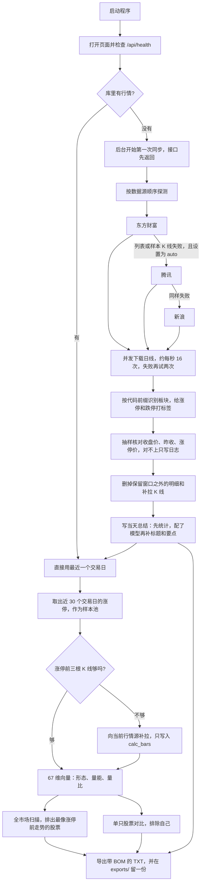
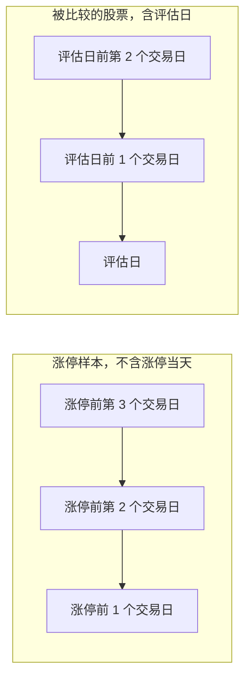

# 三日涨停形态统计系统

看沪深 A 股里，最近涨停的股票在涨停前三天怎么走，再拿其它股票最近三天的走势去比，给出 0 到 100 的形态相似度。

分数只回答「像不像」。它不是涨停概率，也不构成投资建议。

## 目录

1. [核心硬规则](#核心硬规则)
2. [完整数据流程](#完整数据流程)
3. [开发路线图](#开发路线图)
4. [界面设计方向](#界面设计方向)
5. [快速上手](#快速上手)
6. [配置](#配置)
7. [目录结构](#目录结构)
8. [接口](#接口)

更细的口径在 [docs/rules.md](docs/rules.md)，字段和路径在 [docs/api.md](docs/api.md)，每日总结的 JSON 在 [docs/summary_schema.md](docs/summary_schema.md)。

## 核心硬规则

- **相似度不是涨停概率。** 页面顶栏、结果卡片和导出文件里都写着这句原文。
- **只用行情。** 不读新闻、公告、财报，也不让模型改写已经算好的数字。
- **不用未来数据。** 评估日之后的 K 线一律丢掉。样本窗口和候选窗口不是同一段，见下面的流程图。
- **明细只留大约一周。** 行情、涨跌停标签、补拉来的计算 K 线，默认留最近 5 个交易日，可在 3 到 30 之间改。到点删除，同步结束也会删一次。
- **每日总结永久保存。** 数据库里的 `ai_daily_summaries` 和 `summaries/YYYY-MM-DD.json` 不参与上面的清理。
- **只和近 30 个交易日里涨停过的股票比。** 样本池在设置里 3–60 可改；形态特征固定是涨停前 3 根 K 线。明细保留默认 60 个交易日，至少「max(样本池,30) + 8」；形态计算另存 max(样本池,30)+63 天 K 线，position_60 总是按真实 60 日算。同一只股票的全部涨停样本都会排除，避免自己跟自己比。
- **默认只做主板和创业板。** 上证主板 `600/601/603/605`，深证主板 `000/001/002/003`，创业板 `300/301/302`。`302` 仍是创业板，涨跌幅 20%（302132 中航成飞由 300114 改码而来）。科创板 `688/689` 默认剔除，不同步、不进涨停池、不参与打分、不进总结和导出。查询科创板代码会得到「科创板不在纳入范围」。环境变量 `EXCLUDED_BOARDS` 默认是 `star`。B 股（`900`/`200`）、北交所、基金、债券、指数都丢掉。行情源如果把市场前缀标错，以 6 位代码前缀为准。

涨停价按「前收盘 ×（1 + 比例），四舍五入到分」。主板 10%，创业板 20%。主板 ST 在 2026-07-06 之前是 5%，从那天起是 10%；创业板 ST 仍是 20%。2020-08-24 及之后上市的创业板、2023-04-10 及之后上市的主板新股，上市前 5 个交易日不设涨跌幅。没有上市日期时，不做这条豁免。科创板的 20% 规则仍留在判定函数里，默认不参与计算。

## 完整数据流程



下面按这个顺序说明每一步实际做什么。

### 启动和首次同步

桌面程序或 `python -m backend.app.main` 都只监听 `127.0.0.1:8765`。库是空的时候，服务先起来，再在后台同步，不挡住页面。进度看 `/api/sync/status`：阶段、已完成只数、总数、写入数、失败数，以及一句中文说明。

`auto` 的探测顺序是东方财富、腾讯、新浪。列表能拉下来、并且抽一只股票的日线也能拉下来，才认定这个源可用。设置里如果指定了某一个源，这一轮只用它。`auto` 在下载过程中如果某个源开始返回 5xx 或限流，这一只和还没下的股票会改用下一个源，每只行情记下实际来源。

成交量统一成股（手 × 100），成交额统一成元（万元 × 10000），换手率用百分数。日线用不复权，不用腾讯的前复权 `qfqday`，否则涨停价会被缩放。新浪日线常常没有换手率和成交额：换手率尽量用其他源补，成交额补不到就用成交量乘均价估算，并标成估算。

### 沪深识别和涨停判定

每只股票先过代码前缀。过不了的不入库，科创板默认也在这里丢掉。已经在库里的科创板记录，启动和清理时删除。通过的按板块取涨跌幅比例，用前收盘算出涨停价和跌停价，再看收盘是否封住。停牌（成交量为 0）不算涨停。一字板在列表里单独标出来；日线里没有首次封板时间，所以这一列是空的。

### 两种三日窗口

两边都是三个交易日，但起点不同。



样本描述的是「涨停之前的样子」。候选描述的是「到评估日为止的最近三天」。同一天不会被拿去和它自己的涨停样本比。

### 三日涨停池、补拉和打分

样本池只收近 30 个交易日里真正涨停的记录。同一只股票这段时间里涨停多次，会分成多条样本。

明细默认只留 5 个交易日，所以最老那天的涨停，前面三根 K 线经常已经不在正式行情里。打分前会向当前行情源补拉，结果放进 `calc_bars`，不改正式行情。日 K 接口在正式行情没有的日期上，会把这些柱补出来。补拉失败，或补完仍不够三根，这条样本不参加打分，出现在结果的 `skipped` 里，并写明中文原因。补拉同样不能使用评估日之后的数据。清理明细时，早于保留窗口的补拉数据一起删掉。

每根窗口收成 67 个数：20 个日特征 × 3 天（价格走势 35%、K 线结构 20%、成交量 15%、成交额 10%、换手 10%、历史位置 5%），再加 7 个三日汇总（三日趋势 5%）。样本池上拟合稳健缩放（中位数和四分位距）后乘 √权重；欧氏分 = 100·exp(−(d/尺度)²)（尺度 = 样本池两两距离中位数），余弦分 = (cos+1)/2·100，相似度 = 0.8·欧氏分 + 0.2·余弦分（设置可改）。每只候选去掉它自己的全部样本后，取最高、平均、高度相似数（≥90）和档位。完整公式和与旧版文档的差异见 `docs/formulas/`。

页面上的三项是从这 67 维里切出来的，再按固定权重加总：

| 分项 | 权重 | 看什么 |
| --- | --- | --- |
| 形态 | 0.60 | 开高低收、实体、影线、振幅、价格位置 |
| 量能 | 0.25 | 成交量大小和三日量能变化 |
| 量比 | 0.15 | 量比和换手率 |

成交额单独放在 `other_scores.amount`，不进总分。缺成交额时，这项没有区分度，不会被当成 0。两边都没有成交额时，这条参考分会靠在一起，页面上可能接近 100，读的时候不要把它当成「成交额特别像」。

### 全市场扫描和单只对比

扫描把评估日有行情、并且凑得齐三天窗口的股票，逐一去和样本池比，排除自己之后取得分最高的一条，再按分数排序。个股页用同一套分数，并列出样本自己的三天日期，方便和 K 线叠在一起看。

### 每日总结

同步写完会重写最近一个交易日的总结。18:10 再检查一次，这一天还没有文件才补，避免把已经写好的内容覆盖掉。

没填 AI 地址、模型和密钥时，仍然写统计版：涨停家数、板块（主板 / 创业板，没有行业题材，也不含科创板）、连板梯队、量能中位数。`source` 为 `statistics`，`model` 为空。三项都填了之后，模型只许改标题和要点，数字仍以本地计算为准，`source` 为 `ai`。模型失败时统计版留下，原因写在 `ai_error`。

### 导出 TXT

总览、个股相似度、涨停池、每日总结各有一个「导出 TXT」。请求 `GET /api/export`，正文是 UTF-8 带 BOM 的纯文本，方便记事本打开。文件名形如 `scan_2026-10-22.txt`。响应头带 `filename` 和 `filename*`。数据目录的 `exports/` 总会再留一份。表头包含生成时间、数据日期、对比池、数据源，以及「相似度不是涨停概率」。

桌面版如果跑在 pywebview 里，导出会先弹出系统另存为对话框，按 UTF-8 BOM 写入。

### 每日定时任务

时区是北京时间。`LP_SCHEDULER=0` 时全部不跑。

| 时间 | 做什么 |
| --- | --- |
| 17:10 | 同步当天行情，写完接着清理过期明细，并重写当天总结 |
| 17:40 | 再清理一次过期明细 |
| 18:10 | 当天总结如果还没有，补写一份。同步仍在跑时跳过 |
| 11:30（交易日） | 保存上午收盘冻结快照 `snapshots/YYYY-MM-DD-1130.json` |
| 14:50、15:10（交易日） | 配了 AI 时生成 AI 前 20 榜单（盘中快照 / 收盘报价） |

### AI 前 20 榜单

取此刻最相似的前 100 只：交易时段把今天的实时报价当临时日线（11:30-13:00 用上午冻结快照，15:00 后到正式同步前用收盘报价，休市日用最新正式日线），只用已发生的行情，算完临时日线即删，按固定公式算系统综合评分（形态 35% / 技术 20% / 量能 15% / 资金 15% / 历史成功率 15%，缺项摊权重，再按风险分扣 20/10/5），留综合评分前 20 名；AI 只当解读员，写模型依据、风险和一个对照分（页面显示模型分与偏差）。每次运行都存进 `ai_rankings` 表，同时写 `rankings/YYYY-MM-DD.json`（含当天每一次运行），永久保留，清理任务不碰。没配 AI 或 AI 失败时照样按综合评分出榜，只是没有模型依据。评分仍然不是涨停概率。导出类型 `ai_ranking`。

### 实时监控

盯上一交易日最后一次生成的 AI 前 20 名。交易时段（9:30-11:30、13:00-15:00，周一到周五）每 5 秒用腾讯 → 新浪 → 东方财富取快照，一个源失败换下一个。涨幅 ≥3% 为 `warn`：页面弹窗（可选提示音），桌面版弹 Windows 通知；≥6% 为 `alert`：卡片红框闪烁，整个面板变红。同一只股票每天每一级只报一次（`/api/monitor/events`）。桌面程序后台线程每 5 秒读事件，页面没打开也会通知；Windows 通知失败时改用托盘气泡。休市时显示「休市」，不记事件。

周末和节假日没有新行情时，同步可能失败或写不进新的一天。已有的总结不会被删。

### 聚类分析（本地运行）

对近 30 个交易日的涨停样本，用和相似度同一套涨停前三日向量（K 线形态、成交量、量比，标准化后）做 KMeans 或层次聚类，k 可选 2~6 或自动（按轮廓系数挑）。不含涨停当天，不看未来，分组不是涨停概率。

Windows 绿色版只发布聚类版（`LimitPattern-cluster-win64.zip`，已带 scikit-learn）。scikit-learn 在源码里仍是可选依赖，不装时聚类页显示「scikit-learn 未安装」。在本地源码运行：

```bat
cd limit-pattern
py -3.12 -m venv .venv
.venv\Scripts\pip install -r backend\requirements.txt -r desktop\requirements.txt -r requirements-cluster.txt
rem 离线：对导出的特征数据跑聚类
.venv\Scripts\python -m backend.app.tools.cluster --input cluster-data\features.json --k auto --out cluster-result.json
rem 从自己的库导出某天特征数据（JSON 或 CSV）
.venv\Scripts\python -m backend.app.tools.export_features --date 2026-10-29 --out features.csv
rem 启动程序（源码方式，聚类页可用）
set LP_STATIC_DIR=%CD%\frontend\dist
.venv\Scripts\python -m desktop
```

或者直接双击 `run_cluster_windows.bat`。接口：`GET /api/cluster/status`、`POST /api/cluster/run`（`date`、`k`=2~6 或 auto、`method`=kmeans / agglomerative，缺依赖时 503）、`GET /api/cluster?date=`、`GET /api/cluster/features?date=&format=json|csv`，导出类型 `cluster`。结果存在数据目录 `clusters/YYYY-MM-DD.json`。

## 开发路线图

第一阶段是现在仓库里能双击或用源码跑起来的部分。后面的阶段按产品说明书归纳，这一版没有页面，也没有对应接口。

| 状态 | 能力 |
| --- | --- |
| ✅ | 东方财富、腾讯、新浪三个行情源。`auto` 在 5xx 或限流后逐只换源，每只记下实际来源 |
| ✅ | 同步后抽样核对收盘价、昨收、涨停价 |
| ✅ | 沪深 A 股过滤、涨停价四舍五入到分、ST 和新股前 5 日的规则 |
| ✅ | 两种三日窗口、近 30 个交易日涨停池、排除自身、不用未来数据 |
| ✅ | 涨停前 K 线不够时按需补拉，失败写入 `skipped` |
| ✅ | 形态 / 量能 / 量比打分，全市场扫描和单只对比 |
| ✅ | 每日总结的统计版和 AI 版，JSON 永久保留 |
| ✅ | 四页导出 TXT，桌面版可走系统保存对话框 |
| ✅ | 明细按交易日清理，设置页能看保留天数和上次清理时间 |
| ✅ | 空库首次启动自动同步，状态接口用中文说明进度 |
| ✅ | 五个页面：总览、个股相似度、涨停池、每日总结、设置 |
| ✅ | Windows 桌面程序：无控制台、WebView2 窗口、关闭缩到托盘 |
| ✅ | AI 前 20 榜单：前 100 只相似股交给 AI 打分，14:50 / 15:10 自动生成，永久保留，可导出 TXT |
| ✅ | 实时监控上一交易日 AI 前 20：≥3% 弹窗 + Windows 通知，≥6% 红框闪烁 |
| ✅ | 盘中快照：交易时段用此刻报价当临时日线挑 AI 候选，算完即删；收盘后同步前用收盘报价 |
| ✅ | 11:30 冻结：交易日 11:30 存上午快照，午间和下午可选用它给 AI 榜单打分 |
| ✅ | 交易日历：内置 2025-2027 休市安排（2027 为推算），数据目录 holidays.json 可覆盖；定时任务、监控开市判断、上一交易日都按日历 |
| ✅ | 回测：相似度分档和 AI 前 20 榜单的下一交易日涨停率、冲 3% 率、平均涨幅，严格不看未来（受一周明细保留限制）|
| ✅ | 聚类分析（本地运行）：KMeans / 层次聚类、PCA 散点、组中心形态图、导出 TXT 和特征数据；scikit-learn 可选，EXE 不打包 |
| ✅ | 次日观察池：按相似度挑选并附分档历史发生率，不是单只股票的概率；可导出 TXT |
| ⏳ | AI 深度分析：多条证据交给模型写结论，数字仍须能对回本地统计 |
| ⏳ | 行业题材、首次封板时间：现有免费日线/快照接口拿不到可靠数据，暂不做；多个 AI 网关切换、Docker 镜像 |

## 界面设计方向

页面是深色金融终端，不是说明文档。信息靠数字、表格和图，不靠大段解释。

### 整体风格

| 用途 | 颜色 |
| --- | --- |
| 页面底 | `#070b12`，左上偏蓝、右上偏金的两层光晕，再加很淡的网格 |
| 卡片 | 接近 `#0c1220` 的半透明，细边框，大圆角 |
| 顶栏 | 半透明并模糊，滚动时钉在上面 |
| 正文 | `#e7eef8` |
| 次要文字 | `#8ea0bb` |
| 强调 | 金色 `#e8b86d`，用在当前导航、主按钮、对比窗口底纹 |
| 上涨 | `#ff5d73` |
| 下跌 | `#2fdb9a` |

字体优先用文泉驿微米黑、思源黑体、苹方、微软雅黑。数字用等宽对齐。主按钮是金色渐变，次按钮是幽灵边框。

留白按卡片分组：一屏里先是页标题，再是一块操作，再是结果。卡片之间留出缝，不把表格嵌进另一张表格。动效只留给图表入场（大约 280 毫秒）和同步进度条，没有装饰性的循环动画。对比度按深色底上的浅字来配，金色只做强调，不拿来写长句。

### 信息架构

左侧入口：总览、个股相似度、AI 榜单、实时监控、次日观察池、回测、涨停池、每日总结、设置。后面如果做监控、报警、回测，加在设置上面，仍用同一侧栏，不另开窗口。

顶栏从左到右是数据日期、同步状态、实际行情源、版本号。顶栏下面永远有一条声明：「相似度不是涨停概率」。侧栏底部写着「只使用已发生的行情，不预测下一交易日」。

窄屏时侧栏改成顶部，表格横向滚动，不把列挤到看不清。

下面五张图是 2026-10-22 的真实行情，拍摄时还没做「中途换源」和「成交额估算」。那一轮东方财富列表没有连上，腾讯日线中途返回 HTTP 501，于是整轮停在新浪，换手率和成交额是空的。现在 `auto` 会在 5xx 或限流后逐只改用下一个源；成交额补不到会标成估算。

### 总览

上半是同步：按钮、中文进度、已完成/总数、进度条。同步从进行中变成结束时，自动刷新数据日期和排行。

中间是样本池各交易日的涨停家数。下面是全市场扫描表：排名、代码、名称、最高相似度、最相似的涨停样本、平均相似度、高度相似数 / 样本数、档位。点一行进入这只股票的相似度页。最低分和条数在表上方改。右上角是「导出 TXT」。


### 个股相似度

输入 6 位代码和截止日期。还没查的时候，用涨停池里的几只股票当快捷入口。

结果左边是相似涨停列表，右边三块叠在一起：这只股票的日 K（金色底纹标出对比窗口）、与选中样本的叠加图、分项得分。叠加图把两边价格都换成相对各自窗口首日开盘的涨跌，避免高价股和低价股画不到一起。点列表里的另一条会换右侧的样本。导出带上代码和条数。


### 涨停池

只列近 30 个交易日的涨停。可以用日期、沪市/深市、形态、最少连板、代码或名称过滤。表里有收盘、涨幅、连板、封板时间、形态、换手、成交额。封板时间日线里没有，显示「—」。换手率新浪/腾讯日线不带时用流通股本算（估），仍补不到就显示「缺失」。成交额如果是估算，数字后面会标「估」。点一行，用这只股票的涨停日作为相似度页的截止日期。导出使用当前筛选对应的日期；选「全部」时用最近一个交易日作为评估日，文件里仍包含整个样本池。


### 每日总结

左边按日期列出已保存的总结，右边是标题、要点、板块条形图、连板梯队、形态计数和量能。可以展开原始 JSON，也可以重新生成。没配模型时，重新生成得到的是统计版，页面不报「未配置」。


### 设置

数据区：保留交易日（3 到 30）、固定为 3 且不能改的对比窗口、四个数据源按钮（自动、东方财富、腾讯、新浪）、实际连上的源、上次同步、上次清理。

AI 区：模型解读是算出来的状态，地址、模型和密钥都有才算启用。密钥只写入，不回显；留空表示不改。没配齐时总结仍会生成。


### 后续页面怎么排

这些页还没有做，沿用同一套侧栏、卡片和红涨绿跌。

- **盘中监控**：上半是刷新节奏和「还差多少到涨停价」，下半是榜。概率列如果出现，必须写成历史发生率，空着就是「—」，不能显示成 0。
- **报警榜**：单独一张表，只盯前一天挑出的代码。触发时用托盘和窗口标题提示，不新开一套配色。
- **回测**：按相似度分档的柱状图，旁边是样本数。样本太少的档不给百分比。
- **聚类和次日预测池**：仍是表格加一个图，不在这些页上写「建议买入」。

### 图表

- **K 线**：阳线红、阴线绿。下方成交量用同一套颜色。对比窗口用金色半透明块标出，块上写「对比窗口」。接近涨停的收盘可以点一个小标记，标记是辅助，不代替涨停标签。
- **叠加**：横轴是窗口里的第 1、2、3 天，不是日历日期。两条线各用各的基准。某一天没有 K 线时该点空着，不拿后一天去补。
- **得分**：综合分用圆环，分项用横向条。不使用雷达图。三项权重并不相等，雷达会把它们画成同一个多边形，成交额又不进总分，放进雷达更容易看错。
- **板块**：每日总结用横向条形，长度是家数。没有行业数据时，条的名字就是主板、创业板。科创板默认不出现。

### 免责声明放在哪

1. 顶栏常驻，每个页面都能看见，原文是「相似度不是涨停概率」。
2. 扫描和相似度的结果卡片再显示接口返回的 `disclaimer`。接口如果没带回这句，页面仍补上这句。
3. 导出文件的表头用同一句，不改写。
4. 每日总结的页头写「这是复盘，不是交易建议」。总结 JSON 里不另造一句预测。

### 桌面窗口和托盘

双击 `LimitPattern.exe` 后没有黑色控制台。程序用 WebView2 打开内嵌窗口。点关闭是缩到托盘，不是退出。托盘菜单有「显示」和「退出」。同一 Windows 登录会话里只允许一个实例，再次双击会把已有窗口叫出来。

端口默认 8765，被占用就往后加。没装 WebView2 时弹出中文说明，并改用系统浏览器打开同一个地址。数据、日志、总结和导出都在 `%LOCALAPPDATA%\LimitPattern`，不放在程序目录里，避免拷到只读位置后写不进去。

## 快速上手

### Windows 桌面程序

1. 从 GitHub Actions「Build Windows EXE (Cluster)」的构建产物下载 `LimitPattern-cluster-win64.zip` 并解压（这是唯一的 Windows 构建，带 scikit-learn 和样例特征数据 `cluster-data/`，文件夹版，没有单文件 EXE）。
2. 双击 `LimitPattern\LimitPattern.exe`。

本地打包：双击 `build_windows.bat`，默认就是聚类版（`LP_WITH_CLUSTER=1`）。源码里 scikit-learn 仍是可选依赖：不装时聚类页提示「scikit-learn 未安装」，其余功能照常；`set LP_WITH_CLUSTER=0` 后再跑 `build_windows.bat` 可以打不带聚类的标准版（含单文件 EXE），GitHub 上不再构建它。
3. 第一次打开如果库是空的，窗口里会看到同步进度。同步完再看总览和涨停池。

### 源码

```bash
pip install -r requirements.txt
python -m backend.app.main
```

另开一个终端构建页面：

```bash
cd frontend
npm ci
npm run build
```

浏览器打开 http://127.0.0.1:8765 。`frontend/dist` 存在时，同一个端口会带上页面。开发时也可以 `npm run dev`，页面在 http://127.0.0.1:5173 ，接口仍代理到 8765。开发和生产默认都走真实后端，不使用模拟数据。

### Docker

这一版还没有镜像。请用源码或 Windows 程序。

## 配置

| 项 | 默认 | 说明 |
| --- | --- | --- |
| 地址 | `127.0.0.1:8765` | 只绑本机。端口被占用时桌面程序会往后换 |
| `LP_DATA_DIR` | Windows：`%LOCALAPPDATA%\LimitPattern`；其它：`~/.limit_pattern` | 里面有 `lp.db`、`settings.json`、`summaries/`、`exports/`、`logs/` |
| `LP_STATIC_DIR` | 仓库里的 `frontend/dist` | 有 `index.html` 才挂网页 |
| `LP_SCHEDULER` | 开启 | 设为 `0` 关闭 17:10、17:40、18:10 |
| `LP_AUTO_SYNC` | 开启 | 设为 `0` 时，空库启动也不自动同步 |
| `LP_USE_STUB` | 关闭 | 设为 `1` 时桌面程序改用占位接口，正常不要开 |
| 保留交易日 | 5，可改 3–30 | 设置页 |
| 对比交易日 | 3 | 固定 |
| 数据源 | `auto` | 也可指定 `eastmoney`、`tencent`、`sina`。`auto` 遇到 5xx 或限流会逐只换下一个源 |
| `EXCLUDED_BOARDS` | `star` | 默认剔除科创板。设成空字符串才重新纳入。设置页显示当前范围 |
| AI 地址 / 模型 / 密钥 | 空 | 没填齐仍写统计总结。密钥不回显 |

环境变量示例在 `.env.example`。密钥不要写进仓库。

## 目录结构

```
backend/          接口、三个行情源、涨停判定、相似度、总结、导出
frontend/         Vue 页面。构建产物在 frontend/dist
desktop/          Windows 启动器、托盘、PyInstaller
scripts/          打包脚本
tests/            接口和规则测试
desktop/tests/    启动器和打包清单测试
docs/             规则、接口、总结字段、页面截图
requirements.txt  Python 依赖
```

运行后的数据目录：

```
lp.db
settings.json
summaries/YYYY-MM-DD.json
exports/*.txt
logs/launcher.log
```

## 接口

基址 `http://127.0.0.1:8765`。成功时直接返回 JSON。失败时 HTTP 4xx/5xx，正文是 `{"detail": "中文说明"}`。日期是 `YYYY-MM-DD`，股票代码是 6 位。

常用路径：`/api/health`、`/api/settings`、`/api/sync`、`/api/sync/status`、`/api/limitups`、`/api/pool`、`/api/kline`、`/api/similarity`、`/api/scan`、`/api/summaries`、`/api/export`、`/api/ai-ranking`、`/api/ai-ranking/generate`、`/api/ai-ranking/dates`、`/api/monitor`、`/api/monitor/events`、`/api/calendar`、`/api/snapshot/status`、`/api/backtest`、`/api/next-day-pool`。

每个路径的查询参数和字段见 [docs/api.md](docs/api.md)。

## v0.3.0 变更

- **样本池改为近 30 个交易日**（设置 3–60 可改）。形态特征仍是涨停前 3 根 K 线（候选股为含评估日的最近 3 根），两者在代码里本来就是分开的。明细保留默认 40 个交易日，永远不少于「样本池 + 8」（3 根特征 + 5 日量比基准）；同步按保留天数×1.6+10 个自然日拉日线，补拉历史会补到涨停前 8 根。全市场扫描分块向量化（约 5000 只 × 1800 样本 ≈ 3 秒）。每日总结仍永久保留。
- **交易日历**：2025、2026 年已对照上证公告〔2024〕38号、〔2025〕45号（深交所同安排）核对，无误。2027 为推算；收盘后同步若某个“交易日”全市场 0 根日线，推算年份自动记入 `holidays_auto.json`，已公告年份只告警。`holidays.json` 手工覆盖仍然有效。
- **盘中量能时间归一**：按已过连续竞价分钟（240 分钟，午休不算）和 U 形日内分布，把盘中累计成交量/额/换手换算成全天估算值，页面标「估」。
- **换手率**：新浪/腾讯日线不带换手率时，用腾讯行情的流通股本（按天缓存 `float_shares.json`）计算，标为估算；仍拿不到显示「缺失」。成交额缺失时用成交量 × 均价估算。
- **测试提醒**：实时监控页「测试提醒」按钮弹出 ≥3% 和 ≥6% 示例并演示红框 10 秒；桌面通知兜底链：Windows 通知 → 托盘气泡 → 置顶消息框 → 日志，并显示实际用了哪一种。
- **聚类 AI 解读**：勾选「AI 解读各组」后，用同一个 AI 客户端按中心形态数字写一句解读（不预测）；失败时保留规则标签。

## v0.3.1 AI 研究员提示词

- AI 角色：资深 A 股短线交易与涨停板研究员（排名、每日复盘）；聚类解读用分析师口吻。
- 评分框架：K线形态 25%、量能 20%、位置与趋势 15%、涨停基因 15%、相似度 15%、市场环境 10%，减风险扣分（≤20）。输出总分、分项、理由（≤60 字）、风险提示、标签。不是涨停概率，不是买入建议，不用新闻/基本面。
- 喂给 AI 的数据（本地日线，评估日及以前）：近 8 日涨跌/振幅/量比/换手/收盘位置，MA5/10/20 偏离与斜率，近 20/60 日区间位置与距高点，近 30 日涨停次数、末板日期、连板、炸板、涨停后回撤、上影线，相似度分项及前 3 个相似样本；每批附一行市场环境（涨跌家数、涨停/跌停、炸板率、最高连板）。
- 榜单表格可展开看分项、风险扣分和风险提示；TXT 导出包含这些列。每日总结新增「市场复盘」（情绪、高度、炸板、龙头形态）。

## v0.3.3

- 设置文件加 `settings_schema`。旧版文件（保留 5、样本池 3）升级时迁移为样本池 30、保留 40；之后用户自己改的值保留。
- 历史下限 = max(样本池, 30) + 8 个交易日，清理和补全历史都不会低于它。补全范围按交易日历往回数，再留 10 个自然日余量。
- 总览「补全最近 N 个交易日」（5–250，默认 30）：`POST /api/sync/full {"days": N}`。N + 8 超过保留天数时自动抬高保留并提示。保留天数上限 250。总览和设置显示生效中的样本池/保留天数。

## v0.3.4 性能

- 涨停池 `/api/pool`：一次按日期区间 + is_limit_up 的索引查询，连板数一次算好（以前每条涨停都扫一遍全表日期，全市场 30 日会超时）。新增索引 (is_limit_up, trade_date)、(trade_date, is_limit_up)。支持 `?date=`，返回每日家数和空结果原因；页面默认显示最近一个有涨停的交易日。
- 扫描/相似度/聚类：一次性读入日线（两条查询），不再每只股票各查一次。回测只算最近 10 个评估日、不联网补拉、结果缓存。
- 合成全市场库（4600 只 × 40 交易日，约 2400 条涨停）实测：涨停池 0.3 秒、单日涨停 0.04 秒、全市场扫描 3.8 秒、相似度 1.7 秒、回测首次 27 秒（之后缓存）、次日池 3.8 秒。

## v0.4.2 手动采集当日行情

「个股相似度」页和「总览」页顶部有 **采集当前行情并选前100** 按钮。比如 14:00 点一下：

1. 按设置里的数据源（新浪优先，失败按原顺序换源，沿用超时与熔断）拉全部 A 股（不含科创板）实时快照，显示进度，可随时取消；
2. 生成「截至 HH:MM」的临时日线，成交量 / 成交额 / 换手率按已过交易时间换算成全天估算（见下）；
3. 用文档 2 的相似度和样本池对比（快照里的涨停不进样本池），按综合分、预测分给出前 100，标「盘中快照 截至 HH:MM」。

**换算方法**：已过分钟 t 不算午休（9:30–11:30、13:00–15:00，共 240 分钟；午休时 t=120）。全天量能按 U 形分布估计累计完成比例 f(t) = [t + 60·(((t−120)/120)³ + 1)] / 360，量 / 额 / 换手都除以 f(t)（下限 0.02）。换手率先用流通股本按累计量补齐再换算。上午冻结快照逻辑不影响手动采集，手动采集用自己的已过时间。

**时段**：盘中（含午休）用最新行情；15:00 后采整天，标「收盘（15:00）」，不换算；9:30 前或休市日直接提示「今天还没有行情」，可一键改用上一交易日的正式日线。

**隔离**：快照只在计算期间临时写入数据库，算完立即删除；原始行情和结果存到 `data/snapshots/manual/YYYY-MM-DD.json`（当天最新一次）和 `YYYY-MM-DD-index.json`（当天各次采集时间）。不进样本、不进回测；收盘同步拿到正式日线后快照标为「已被正式日线替换」，当天不能再采。

「导出 AI 输入（快照）」= `GET /api/ai-input?snapshot=manual`，「用快照生成 AI 排名」= `POST /api/ai-ranking/generate {"snapshot":"manual"}`。

实测（新浪，4,600 只）：拉行情约 4–5 秒；首次全链路 47 秒（含档位回测冷启动），之后约 13 秒。

## v0.4.3 回测预热

启动后、每次同步 / 补数完成后、以及改了样本池 / 权重 / 阈值 / 分档设置后，后台线程预热预测分要用的档位回测缓存（不阻塞启动和桌面窗口）。用户在预热中点按钮会等这次预热算完直接用，不会重复算。`GET /api/backtest/warm` 看状态，手动采集卡片上显示「回测预热中…」。设 `LP_WARM=0` 可关闭。实测真实数据：预热约 30 秒，之后首次手动采集约 16 秒（含约 5 秒拉行情）。

## v0.4.4 切换页面不丢数据、总览快照卡片

- 之前每个页面的结果都放在页面自己的变量里，左侧一切换页面就被卸载、数据清空。现在所有页面（设置页除外，每次重新读取）用 keep-alive 保留：计算结果、选中的日期、筛选、正在跑的进度和滚动位置都留着。
- 手动采集的状态放到共享 store（总览和个股相似度共用）；首次打开从后端读回最近一次快照（`data/snapshots/manual`），重启程序也在；后台若还在采集，回来接上进度，不会重新开始。AI 榜单页回来时，若后台正在生成（别处点的或重启前开始的）也接上进度。实时监控页离开时暂停轮询。
- 总览的「手动采集当日行情」卡片显示标签、只数、样本池、耗时和前 5，带「查看完整前 100」「导出给AI分析」（TXT / .md）「生成AI榜单」。
- 桌面程序里导出走系统另存为对话框，保存后显示路径并可「打开所在文件夹」；浏览器里直接下载。

## v0.4.5 外部 AI 导入按外部排序

导入外部 AI 结果会替换当天榜单（作为当天最新一次运行，页面和次日监控都读它），并按外部 AI 的分数排名（同分保持它给的顺序），不再按系统综合分重排。分数列醒目显示外部分，下方是系统综合分和差值；页面上有「排序：外部 AI / 系统综合分」切换（导入的榜默认外部 AI，系统生成的默认综合分）。不在前 100 候选里的代码单独计算综合分，算不出显示 —，都保留。超过 20 只、重复、代码无效或本地不存在的条目逐条列在 `rejected`（代码 + 原因），导入成功提示「已替换 YYYY-MM-DD 榜单：N 只，按外部 AI 排序」。

## v0.4.6 休市不再闪烁报警

报警与否统一由后端判断（交易日历 + 9:30–11:30 / 13:00–15:00 + 「仅在交易时段报警」）。非报警时段 `/api/monitor` 的每只股票 `level` 一律为 `normal`（原级别放在 `raw_level`），报警计数为 0，并给出 `price_label`（如「上一交易日 10-30 收盘（报警暂停）」）；`/api/monitor/events` 不发事件。总览卡片、实时监控页、页面弹窗 / 声音、桌面通知都只看这个判断，进入非报警时段时清掉残留弹窗。总览卡片和监控页按榜单页同一顺序列出（外部导入按外部 AI 分，0.4.5 前导入的旧榜读出时也会重排）。

## v0.4.7 每日总结区间导出

「每日总结」页顶部：开始 / 结束日期、快捷区间（近 5 / 20 / 60 交易日、本月、全部）、格式（TXT 默认、Markdown、JSON、CSV），一键「导出」。内容：区间、交易日数、有总结天数、缺总结的交易日列表、导出时间；每天完整总结（市场、复盘、要点、AI 总结、板块、连板梯队、形态、量能、其余字段）；末尾区间汇总（日均涨停、平均炸板率、最高连板及逐日表）。总结永久保存，可以早于日线保留期；一次最多 5 年。TXT / CSV 带 UTF-8 BOM（记事本、Excel 直接认中文），JSON 不带。桌面程序走另存为对话框并可打开所在文件夹，浏览器直接下载，默认文件名 `每日总结_开始_结束.格式`。

## v0.4.8 自选股

- 左侧「自选股」页：输入代码（可带 sh/sz/bj 前缀或 .SH 后缀）、名称（可只输一部分，如「重庆啤」）或拼音首字母（如 cqpj，离线 GB2312 区位表，零依赖）自动补全，回车或点击加入；单行删除、勾选批量删除、清空（确认）、备注、上下移动排序。列表存在 `data/watchlist.json`，重启保留。
- 科创板（688/689）允许加入自选（行情单独用新浪拉），标「科创板，不在相似度样本池」，相似度和综合分显示 —。
- 一键导入：粘贴或选 TXT/CSV/JSON 文件（UTF-8 或 GBK），逗号 / 空格 / 换行 / Tab 分隔的代码或名称，SH600132、600132.SH、「600132 重庆啤酒」这类同花顺 / 东方财富导出行，以及外部 AI 的 JSON（items 或 stocks 列表）。先预览：匹配、多候选（选一只）、找不到、重复，再确认。也可一键加入 AI 榜单或手动采集前 100。导出 TXT / CSV（UTF-8 BOM）。
- 实时监控：现价、涨跌幅、量比（按已过交易时间折算）、涨停标记、最高最低，以及最近 AI 榜单 / 手动快照里的相似度和综合分。一次批量请求，交易中 5 秒一轮、其他时段 60 秒，全局只有一个轮询。报警阈值与时段规则和 AI 榜单监控相同（≥3% 提醒、≥6% 红框，午休 / 收盘后 / 周末节假日不报警，只显示最后行情）；设置里「自选股报警」可关。实时监控页和总览各有一个自选股卡片。
- 外部 AI 导入还接受 `{"title","market_sentiment","stocks":[{code,name,score,deepseek_score,priority,reason,risk}],"market_risk","disclaimer"}`：按 priority 排序（没有再按 score、给定顺序），其他 `*_score` 显示在分数下面，标题 / 市场判断 / 免责声明单独显示，name 只用来核对（不一致提醒，仍按代码）；不足 20 只也可以，监控就用这几只。
